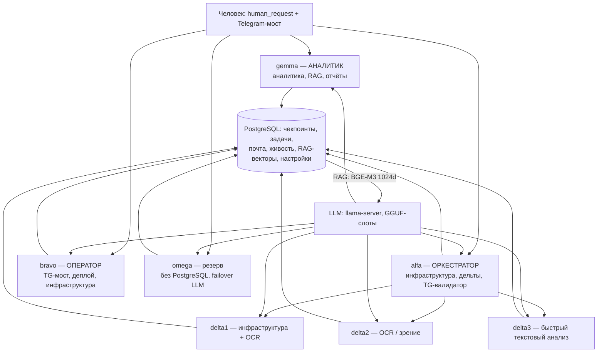

# longlive — кластер долгоживущих ИИ-агентов

## 1. Что это и зачем

**Честное позиционирование: это инженерный разбор работающей системы + уроки —
не «проект для запуска».** В репозитории нет runnable-кода: есть устройство каркаса,
механизмы ядра, реальные кейсы с root-cause и осознанные отказы. Ценность — в идеях
и опыте, а не в «попробуй сам» (минимальный runnable-каркас запланирован отдельным
релизом, см. §10).

Система: **10+ LLM-агентов, которые живут неделями** (3 основных + 3 сабагента + omega-резерв + 3 лёгких + фоновые). Каждый агент — бесконечный цикл
`запуск → работа (tool-calls) → рестарт (сброс контекста) → снова`, который никогда не
«заканчивается» и не ждёт, пока человек нажмёт кнопку. Агент сам решает, когда спать,
когда перезапускаться и когда попросить человека о решении. Память между перезапусками
— не контекст LLM, а **обычная таблица PostgreSQL**: «кто я» восстанавливается одним
SELECT из последнего чекпоинта. Всё на локальных GGUF-моделях (llama.cpp,
OpenAI-совместимый API) — никаких облачных LLM.

Зачем так, а не взять готовое (LangGraph, CrewAI, AutoGen):

1. **Контекст LLM конечен, работа — нет.** Любой фреймворк упирается в окно модели.
   Здесь «личность» вынесена наружу: рестарт — это фича, а не сбой.
2. **Система должна работать, пока человек спит.** Ночью агенты сами спят, сами
   просыпаются по таймеру, сами замечают, что напарник умер, и эскалируют это утром.
3. **Каждый агент — узкая роль под конкретный контур** (оркестратор, оператор,
   TG-мост, исполнители), а не универсальный «суперагент».



## 2. Пять ключевых идей

1. **«Я» = последний чекпоинт в БД.** После сброса контекста агент первым делом
   выполняет `SELECT request_payload FROM analyst_daemon_queue WHERE agent='я'
   ORDER BY created_at DESC LIMIT 1` и продолжает с того, где остановился.
   Личность — данные, не процесс.
2. **Сон — состояние, а не отсутствие.** Нет задач → агент пишет в `agent_sleeps`
   (wake_at, reason) и чисто выходит; watchdog каждые 5 минут будит его по таймеру
   или досрочно (`need_work=true`). Человек видит, что агент «спит до 08:30»,
   а не «сломался».
3. **Память — PostgreSQL, не контекст.** Чекпоинты, задачи, почта между агентами,
   живость, RAG-векторы — всё в одной БД. Рестарт, падение, смена хоста —
   ничего не теряется.
4. **Две границы контекста, три сценария** (floor и плановый совпадают по умолчанию — 80%, разводятся только настройкой):
   - **граница floor — 80%** (`controlled_restart_threshold`, валидация 50–94): ниже порога
     `request_restart` **отказывается** («рестартовать почти пустой цикл
     бессмысленно», плюс минимум 3 tool-calls за цикл) — защита от «побега
     в рестарт»: модель не может сбросить контекст, когда цикла ещё почти нет;
   - **плановый** — по умолчанию = floor (80%): NOTE «контекст выше порога» →
     завершённый шаг = `save_progress` + controlled restart;
   - **граница hard — 95%** (`context_usage_percent`): лимит окна, safety net.
   Три сценария: ctx < floor → рестарт отклонён, цикл продолжается; floor ≤ ctx < hard
   → агент сам поднимает плановый рестарт; ctx ≥ hard → safety-net. Сложная задача —
   плановый рестарт у 80%; рутина — до 95% или в сон. Никогда не «допирается до края».
5. **Якорь живости.** Каждый цикл агент обновляет `lives.last_heartbeat_at`;
   напарник молчит >1 часа — трёхшаговая проверка (heartbeat → журнал действий →
   артефакты) и, при подтверждённой смерти, эскалация человеку. Система замечает
   смерть напарника сама, ночью.

Полный разбор механизма (пороги, K1, F3, bounding) — [harness_report.md](harness_report.md) §2.

## 3. Чего мы НЕ берём (осознанные отказы)

Самая полезная часть документации: список отказов стоит больше, чем список фич.

| Идея из «модных» harness-ов | Почему отказались |
|---|---|
| Мульти-агентные рои (swarms, проекты с 81k★) | 3 основных агента + 3 исполнителя — уже максимум, который мы можем координировать. Больше агентов = боль координации, а не скорость |
| Kafka/брокеры сообщений для агентов | Оверкилл: PostgreSQL-очереди (`agent_mailbox`, `tg_message_queue`) решают задачу и дают транзакционную атомарность, которой у нас не было с брокером |
| Self-improvement без ревью | Опасно именно для долгоживущих: откат одной строкой не спасёт, если агент «улучшил» своё ядро. `core/` меняется только через ревью человека |
| MCP-серверы «для галочки» | Только при реальном переходе на экосистему; инструменты уже кастомные под контур |
| Vision-управление терминалом, voice-to-code | Не наш контур |

## 4. Как устроен цикл агента (5 строк сути)

Один и тот же каркас у всех агентов (различаются модель, промт и набор инструментов):
bootstrap восстанавливает «я» из последнего чекпоинта и ставит heartbeat; цикл =
heartbeat → LLM (свой слот llama-server) → tool-loop с pre-flight валидацией
(K1) и bounding-ом вывода; при ~80% контекста — чекпоинт + controlled restart
(чистый выход, процесс поднимается заново); нет задач — спячка с watchdog.

```python
# core/longlive_memory.py (выжимка) — «я» = последний чекпоинт
def load_last_checkpoint(cur, agent: str):
    cur.execute(
        """SELECT request_payload, agent_reasoning
             FROM analyst_daemon_queue
            WHERE request_payload->>'agent' = %s
              AND request_type = 'checkpoint'
            ORDER BY created_at DESC LIMIT 1""", (agent,))
    row = cur.fetchone()
    # payload = {done:[...], remaining:[...], key_facts:[...], artifacts:[...]}
    return row  # вшивается в первичный промт следующего цикла
```

Ключевые механизмы: **K1 pre-flight** (валидация tool-call ДО execute; ошибка —
ToolMessage «исправь JSON», а не 500/рестарт — модель неуязвима для собственных
опечаток), **F3 correction** (разбей большой write на чанки, 3 попытки),
**Output bounding** (длинный вывод → файл + отсечка в промпт), **BaseException-safe**
(SystemExit/KeyboardInterrupt из инструмента не убивают агента).
Полный цикл и все пороги — [harness_report.md](harness_report.md) §2 (канон).

## 5. Архитектура памяти (кратко)

10+ таблиц PostgreSQL: чекпоинты («личность»), канал с человеком, очередь задач
с протоколом цепочек v2.1 (reader/claim/pipeline `new→analyze→plan→execute→done`),
меж-агентная почта, якорь живости, спячка, RAG-векторы, настройки, TG-очередь.

Полная таблица всех таблиц и протокол v2.1 — [harness_report.md](harness_report.md)
§3 (канон). Здесь — не повторяем.

## 6. Безопасность (сводка)

- **NEVER-REVEAL**: пароли, токены, ключи, креды, внутренние IP+порты БД не покидают
  контур; в документации — плейсхолдеры, перед публикацией — grep-аудит.
- **Path-guard**: каждый файловый/SSH-инструмент проходит единый guard разрешённых
  каталогов; список обновляется из БД каждые 30 с.
- **SQL-политики**: read-only режим (`allow_write=False`) — базовый для «чужих»
  данных; guest-роли в TG вообще не могут писать.
- **K1 pre-flight**: валидация tool-call ДО исполнения.
- **Роли в TG**: owner — полный; project — read-only; guest — только рекомендации
  (write-интент = совет, не команда). Danger-паттерны → отказ.
- **Иерархия кода**: `core/` и `tools/` (эталон) — только через ревью человека;
  агент пишет только в свой `workspace/`.

Модель угроз — что защищаем и что НЕТ — [harness_report.md](harness_report.md) §8
(канон).

## 7. Кейс: «одна задача — два раза» (реальный, не учебный)

**Ситуация.** Человек написал в Telegram одну фразу. Через 20 минут в очереди задач —
ДВЕ задачи с одинаковым содержанием.

**Root-cause (по строкам БД).**
1. TG-поллер записал сообщение **одной** строкой — дедуп на уровне сообщений сработал.
2. Но задачи из сообщений создают **сами агенты** в своих циклах: агент читает
   `tg_message_queue`, решает «это новая задача» и делает INSERT в очередь задач.
3. Два долгоживущих агента в **перекрывающихся циклах** независимо увидели одно и то
   же сообщение — и каждый сам вставил задачу. Перед INSERT никто не проверял, не
   создана ли уже задача из этого источника; идемпотентного ключа в таблице не было.
   Оба INSERT прошли успешно.

**Фиксы.**
1. **Единый intake**: задачу из TG создаёт ОДИН компонент, атомарно в той же
   транзакции, что и пометка «сообщение обработано».
2. **Идемпотентный ключ**: `source='tg:<chat_id>:<msg_id>'` + partial unique index →
   второй INSERT гарантированно падает (`ON CONFLICT DO NOTHING`).
3. **Pre-flight**: перед INSERT — SELECT по source; если задача уже есть — не
   создавать, а стать «читателем» существующей.

**Обобщение:** в распределённой системе «кто-то уже сделал» надо проверять
**на уровне сущности** (задача), а не только на уровне её источника (сообщение).

## 8. Ограничения (честно: что работает плохо / не решили)

- **Polling БД вместо событий.** Агенты читают очереди по таймеру/в цикле, а не по
  событию: латентность до интервала цикла + лишняя нагрузка на PostgreSQL.
- **Оценка контекста приблизительная.** ContextBudget считает токены через tokenize
  API + UTF-8 fallback; держит пиковое значение, не среднее.
- **Основной контур привязан к Windows.** Каталоги агентов и запуск — на Windows-хосте;
  перенос на чистый Linux не завершён.
- **Нет distributed tracing.** Отладка — по журналам, артефактам и `agent_coordination`,
  а не по трейсам.
- **3 основных агента — потолок координации** (см. §3).
- **RAG возвращает карточки, а не «вспомнил».** Актуальность решает сам агент —
  дисциплиной, не механизмом.

Полный список — [harness_report.md](harness_report.md) §10 (канон).

## 9. Масштаб (реальные цифры на 11.11.2026)

- **Агенты**: 3 основных (gemma, alfa, bravo) + 3 сабагента (delta1/2/3) + omega
  (резерв, без PG) + 3 лёгких (lima/lima1/lima2) + фоновые сабагенты-инструменты.
- **В эксплуатации**: с 22.09.2026 (50 дней до 11.11.2026; не «непрерывно» — были
  инциденты и отключения света).
- **Циклы**: 339 controlled-restart-циклов основных агентов (gemma 25, alfa 205,
  bravo 80, delta1/2 по 14, delta3 1 — счётчик `lives.restart_count`; сумма = 339).
- **Память**: 2704 RAG-карточки (pgvector, BGE-M3 1024d, GPU ~1 с/запись);
  ~8500 чекпоинтов в `analyst_daemon_queue`.
- **Инференс**: локальные GGUF, окно до ~140k; чистые замеры одного 2×GPU-размещения:
  llama.cpp ≈ 50 ток/с, vLLM (AWQ, tensor-parallel 2) ≈ 86 ток/с.

Цифры — из живых таблиц (`lives`, `knowledge_base`, `analyst_daemon_queue`),
не маркетинг.

## 10. Структура репозитория

```
README.md            ← вы здесь (входная точка)
harness_report.md    ← КАНОН: каркас, две границы контекста, таблицы+v2.1, TG, RAG, кейс,
                       безопасность+модель угроз, ограничения, масштаб
how_we_work.md       ← RUNBOOK: добавить агента, зависший агент, ротация модели,
                       восстановление после потери БД, каталоги
alfa_harness.md      ← агент alfa: каталог, core/, tools/, логика инструментов, уроки
gemma_harness.md     ← агент gemma: каталог, core/, tools/, уроки
bravo_harness.md     ← агент bravo: TG-мост, деплой, логика инструментов
deltas.md            ← сабагенты delta1/2/3: профили моделей, эскалация
CHANGELOG.md         ← история версий документации
LICENSE              ← лицензия
```


## 11. Глоссарий

| Термин | Что это |
|---|---|
| **longlive** | режим «долгоживущего агента»: бесконечные циклы до явной остановки человеком |
| **цикл (cycle)** | один прогон `запуск → работа → рестарт`; после рестарта контекст чист |
| **чекпоинт** | запись состояния агента в БД (done/remaining/key_facts/artifacts) |
| **controlled restart** | плановый перезапуск цикла (чекпоинт → чистый выход); floor-отказ (ctx < 80% + <3 tool-calls) не даёт сбросить почти пустой цикл |
| **ContextBudget** | учёт «места в окне» LLM; две границы: floor 80% (плановый = floor по умолчанию) / hard 95% |
| **sleep / sleep-guard** | спячка агента (запись `agent_sleeps`) + чистое завершение процесса |
| **lives / heartbeat** | якорь живости: каждый цикл агент обновляет `lives.last_heartbeat_at` |
| **owner** | агент-владелец задачи (единственный, кто двигает её pipeline) |
| **pipeline v2.1** | протокол цепочек задач: `new→analyze→plan→execute→done` |
| **reader-merge** | каждый агент, прочитавший задачу, ставит свой ключ в `task_notes.readers` |
| **Z3** | правило: owner молчит 30 мин → второй агент НЕ забирает задачу, а эскалирует |
| **K1** | pre-flight валидация tool-call (схема аргументов) до исполнения |
| **RAG** | retrieval-augmented generation: поиск по векторам (BGE-M3, 1024d) |
| **NEVER-REVEAL** | список данных, которые никогда не покидают контур (секреты, IP+порты БД) |
| **path-guard** | единая проверка путей всех файловых инструментов по allowed dirs |
| **TG-валидатор** | агент, проходящий входящие TG-сообщения по чек-листу (danger/валидность/scope/write) |
| **vault** | хранилище секретов (KV-маунты / agent_settings в БД) |
| **сабагенты (deltaN)** | исполнители того же каркаса; сложные решения эскалируют оркестратору |
